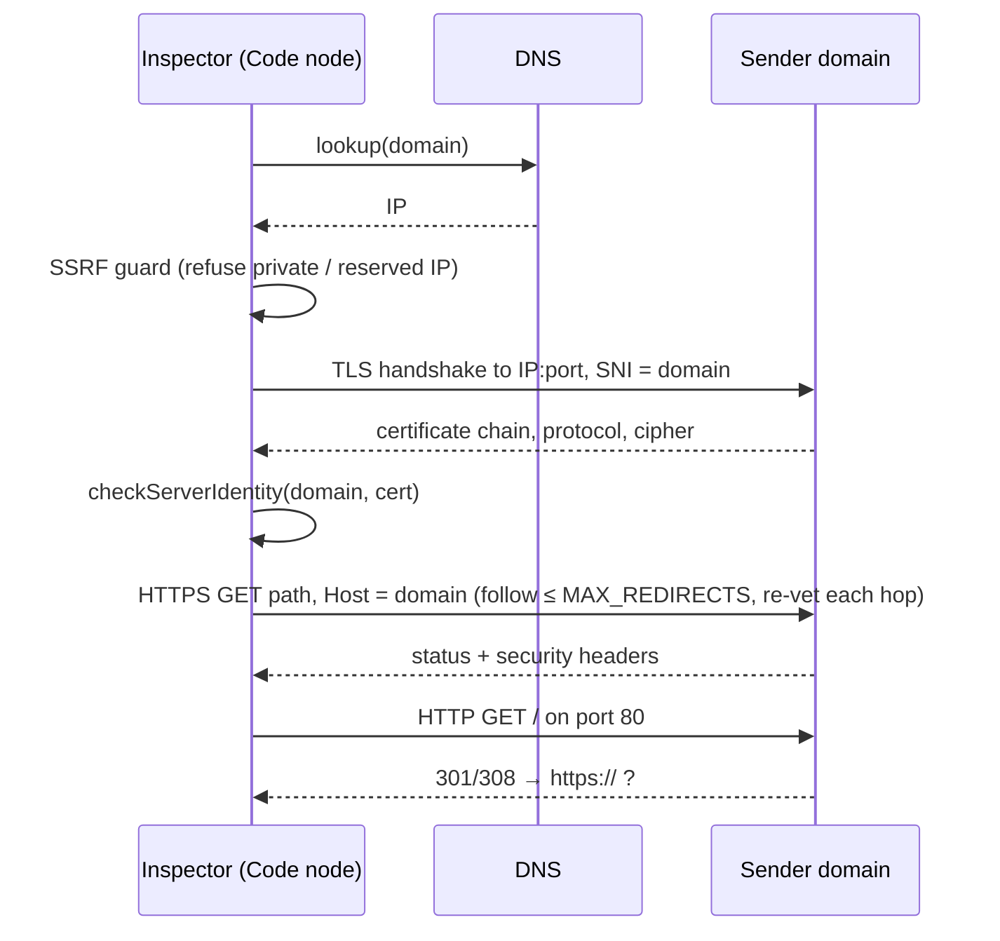

<div align="center">

# n8n-outbound-sender-domain-ssl-expiry-watchdog

**Automated security cron job that monitors SSL certificate expiration dates, TLS validity, and core security headers across outbound sender domains, alerting via Slack/Webhook or logging into HubSpot/Notion when certificates are nearing expiration or headers are missing.**

A dhRobin Systems Revenue Infrastructure blueprint

     

</div>

---

## Table of Contents

1. [Overview](#1-overview)
2. [Architecture and Data Flow](#2-architecture-and-data-flow)
3. [Repository Contents](#3-repository-contents)
4. [Prerequisites](#4-prerequisites)
5. [5-Minute Sandbox Quick Start](#5-5-minute-sandbox-quick-start)
6. [Step-by-Step Import and Configuration Guide](#6-step-by-step-import-and-configuration-guide)
7. [Environment Variables](#7-environment-variables)
8. [Node-by-Node Configuration Guide](#8-node-by-node-configuration-guide)
9. [Findings and Severity Model](#9-findings-and-severity-model)
10. [Safety Matrix](#10-safety-matrix)
11. [Security and Data Protection](#11-security-and-data-protection)
12. [Operations and Troubleshooting](#12-operations-and-troubleshooting)
13. [Disclaimer and License](#13-disclaimer-and-license)

---

## 1. Overview

Outbound programs depend on a surprising number of HTTPS endpoints that nobody watches: the click-tracking domain behind every link in every sequence, branded link and image hosts, preference centers, landing pages, webmail, and the implicit-TLS submission port of the mail server. When one of those certificates lapses, recipients see a browser warning on the first click, link-scanning gateways start flagging your mail, and reply rates fall before anyone files a ticket.

I built this watchdog to catch that a month early. Once a day it opens a real TLS connection to every sender domain and checks:

- **Certificate:** days to expiry, not-yet-valid, chain trust against the n8n host's CA store, hostname coverage (SANs), intermediates expiring, RSA key size.
- **TLS:** negotiated protocol (TLS 1.2 or later required) and cipher.
- **Security headers:** `Strict-Transport-Security` (present, `max-age` ≥ 180 days), `Content-Security-Policy`, `X-Frame-Options` (or CSP `frame-ancestors`), `X-Content-Type-Options: nosniff`, with `Referrer-Policy` and `Server` version disclosure reported as info.
- **Transport:** whether `http://` redirects to `https://`, and whether the HTTPS redirect chain stays on HTTPS.

Findings are graded `critical`, `warning` or `info`. Anything at or above `ALERT_MIN_SEVERITY` goes to **Slack** (one summary per run), a **generic webhook** (one JSON document per run), **HubSpot** (one task per domain) and/or **Notion** (one incident page per domain).

**Design principles**

| Principle | Implementation |
|---|---|
| Safe by default | With no environment variables set, the workflow generates **no DNS, TLS or HTTP traffic and sends no notifications**. |
| Built-ins only | Inspection uses Node.js `dns`, `tls`, `https`, `http` and `net`. No packages, no external scanning service. |
| SSRF guarded | Every host and every redirect target is resolved first. Private, loopback, link-local, CGNAT and multicast addresses are refused unless `ALLOW_PRIVATE_TARGETS=true`. The connection goes to the vetted IP with SNI and `Host` set to the domain, so DNS can't be re-pointed between check and connection. |
| Observation separate from judgement | The inspector records raw facts. *Evaluate Findings* applies the thresholds, so the sandbox exercises exactly the same rules as production. |
| Quiet records, loud chat | Slack and webhook alerts repeat every run while a problem persists. HubSpot tasks and Notion pages are created only when a domain's findings change, or every `RECORD_REPEAT_DAYS`. |
| Secrets out of data | Webhook URLs and tokens appear only as `{{ $env.* }}` in HTTP URL and header fields. The config node stores only whether each secret is set. |

---

## 2. Architecture and Data Flow

```mermaid
flowchart LR
    SCH[Daily Watchdog Schedule<br/>06:00 UTC] --> CFG
    MAN[Manual Test Trigger] --> CFG[Config & Safety Gate]
    CFG --> SRC{Domain Source: URL?}
    SRC -- yes --> FET[HTTP: Fetch Domain List] --> LD
    SRC -- no --> LD[Load & Normalize Domain List<br/>fixture · SENDER_DOMAINS · URL]
    LD --> HD{Has Domains?}
    HD -- no --> AUD
    HD -- yes --> SB{Sandbox Mode?}
    SB -- yes --> MOCK[Mock Inspection Results]
    SB -- no --> INS[Security Inspection TLS + Headers<br/>dns → SSRF guard → tls → https → http]
    MOCK --> EV[Evaluate Findings<br/>severity per finding]
    INS --> EV
    EV --> CMP[Compose Alerts<br/>Slack · webhook · HubSpot · Notion]
    CMP --> AF{Alerts Found?}
    AF -- no --> AC{Post All-Clear?}
    AC -- yes --> SAC[Slack: Post All-Clear] --> AUD
    AC -- no --> AUD
    AF -- yes --> DR{Dry Run?}
    DR -- yes --> AUD
    DR -- no --> SE{Slack Enabled?}
    SE -- yes --> SL[Slack: Post Alert] --> WE
    SE -- no --> WE{Webhook Enabled?}
    WE -- yes --> WH[Webhook: Post Alert] --> HE
    WE -- no --> HE{HubSpot Enabled?}
    HE -- yes --> HS[HubSpot: Create Tasks] --> NE
    HE -- no --> NE{Notion Enabled?}
    NE -- yes --> EN[Emit Notion Pages] --> NP[Notion: Create Incident Page] --> AUD
    NE -- no --> AUD[Execution Summary & Audit]
```



### Per-domain inspection sequence



### Stage contracts

| Stage | Output shape |
|---|---|
| Load & Normalize Domain List | `{ source, count, domains: [{ domain, port, path, role, owner, checkHeaders, checkRedirect, requiredHeaders, warningDays }], rejected[] }` |
| Mock / Security Inspection | `{ mode, durationMs, observations: [{ domain, port, resolvedIp, error, tls{ authorized, authorizationError, identityError, protocol, cipher, cert{}, chain[] }, https{ status, headers{}, hops[], firstHsts }, http{ status, location, redirectsToHttps } }] }` |
| Evaluate Findings | `{ counts{ domains, ok, info, warning, critical, alerting }, results: [{ domain, port, status, alert, daysRemaining, validTo, issuer, protocol, findings[], fingerprint }] }` |
| Compose Alerts | `{ alertCount, slackBody, webhookBody, hubspotTasks[], notionPages[], suppressedRecords }` |
| Execution Summary & Audit | Outcome, safety flags, thresholds, domain list stats, per-domain status and finding codes, channel results |

---

## 3. Repository Contents

```
n8n-outbound-sender-domain-ssl-expiry-watchdog/
├── README.md                       Technical documentation (this file)
├── workflow.json                   Importable n8n workflow with sticky notes and pinned synthetic payloads
├── DISCLAIMER.md                   Liability limitation and usage terms
├── LICENSE                         MIT License
└── sample-payloads/
    └── domains-list.json           Synthetic sender-domain list (also embedded in the sandbox loader)
```

All domains use reserved example names (`sender.example.com`, `mail.example.com`, `links.example.net`, `go.example.org`, …). None of them belong to a real sender.

---

## 4. Prerequisites

| Requirement | Detail |
|---|---|
| n8n | Self-hosted **1.60 or later** (Schedule Trigger 1.2, Set 3.4, IF 2, Code 2 with top-level `await`, HTTP Request 4.2, `v1` execution order). |
| Node built-ins in Code nodes | `NODE_FUNCTION_ALLOW_BUILTIN=dns,tls,https,http,net`. Without it, the live inspector stops with a message naming this variable. If n8n runs Code nodes in external **task runners**, set the variable on the runner container too. |
| Env access | `N8N_BLOCK_ENV_ACCESS_IN_NODE=false`, so `{{ $env.* }}` expressions resolve. |
| Network egress | The n8n host (or task runner) must reach each sender domain on its port (usually 443) and on port 80 if `CHECK_HTTP_REDIRECT=true`. |
| Trust store | Chain trust is evaluated against Node.js's bundled CA store. For an internal CA, add it with `NODE_EXTRA_CA_CERTS=/path/ca.pem`. |
| Slack (optional) | An incoming webhook URL for the alert channel. |
| Webhook (optional) | Any HTTPS endpoint that accepts JSON, with an optional bearer token. |
| HubSpot (optional) | A private app with the write scope HubSpot lists for the Tasks API. |
| Notion (optional) | An internal integration token and a database shared with it. The database needs only a title property (`Name` by default). |

> **n8n Cloud:** Code nodes on n8n Cloud can't load `tls`, `dns` or `net`, and you can't define your own environment variables there. Run this workflow on self-hosted n8n.

> **Out of scope:** STARTTLS on SMTP ports 25 and 587, MTA-STS policy content, DANE/TLSA and DNS records such as SPF, DKIM and DMARC are not checked. Implicit TLS on port 465 is supported (set `"checkHeaders": false`).

---

## 5. 5-Minute Sandbox Quick Start

1. **Run n8n locally:**
   ```bash
   docker run -it --rm -p 5678:5678 \
     -e N8N_BLOCK_ENV_ACCESS_IN_NODE=false \
     -e NODE_FUNCTION_ALLOW_BUILTIN=dns,tls,https,http,net \
     -e GENERIC_TIMEZONE=UTC \
     -v n8n_data:/home/node/.n8n \
     docker.n8n.io/n8nio/n8n
   ```
2. **Import** `workflow.json` (*Workflows → Import from File*).
3. Click **Test workflow** on *Manual Test Trigger*.
4. Open **Evaluate Findings**, **Compose Alerts** and **Execution Summary & Audit**.

**Expected sandbox result** (`sample-payloads/domains-list.json`, no network traffic, nothing sent):

| Domain | Status | Findings |
|---|---|---|
| `promo.example.com` | 🔴 critical | DNS lookup failed |
| `links.example.net` | 🔴 critical | Certificate expired 3 days ago |
| `track.example.com` | 🔴 critical | Expires in 5 days · HSTS, CSP, X-Frame-Options missing · no HTTP→HTTPS redirect |
| `go.example.org` | 🔴 critical | Certificate covers `*.cdn.example.net` only · HSTS `max-age=86400` too short |
| `legacy.example.com` | 🔴 critical | Self-signed (untrusted) · TLS 1.1 · 1024-bit RSA · all required headers missing · Server version disclosed |
| `mail.example.com` | 🟠 warning | Expires in 21 days · CSP missing |
| `sender.example.com` | 🟢 ok | — |
| `bounce.example.com:465` | 🟢 ok | Implicit TLS, 120 days, headers not applicable |

Rejected by the loader: `archive.example.com` (disabled), `not a domain!` (invalid hostname), `SENDER.example.com` (duplicate after lower-casing). The audit outcome is `alerts_found_sandbox`, and *Compose Alerts* holds the Slack blocks, webhook JSON, 6 HubSpot tasks and 6 Notion pages that a live run would send.

---

## 6. Step-by-Step Import and Configuration Guide

Each step changes one thing and has an exit check.

| Step | Configuration | Exit check |
|---|---|---|
| **1. Import and sandbox** | Defaults | The table in [§5](#5-5-minute-sandbox-quick-start) is reproduced. |
| **2. Live inspection, dry run** | `SANDBOX_MODE=false`, `SENDER_DOMAINS=<your domains>` (see [§8.2](#82-load--normalize-domain-list)) | *Evaluate Findings* lists every domain with real expiry dates that match what a browser shows. Nothing is sent (`alerts_found_dry_run` or `all_clear`). |
| **3. Tune** | `DAYS_WARNING_THRESHOLD`, `CRITICAL_DAYS`, `REQUIRED_HEADERS`, per-domain `requiredHeaders` / `checkHeaders` / `warningDays` | Remaining alerts are ones you intend to act on. Tracking domains served by an ESP often can't set CSP; drop it for those domains rather than living with permanent noise. |
| **4. Slack** | `DRY_RUN=false`, `ALERT_CHANNELS=slack`, `SLACK_WEBHOOK_URL` (a test channel first) | One summary message per run. Optionally `SLACK_POST_ALL_CLEAR=true` for a daily heartbeat. |
| **5. Webhook / HubSpot / Notion** | Add channels to `ALERT_CHANNELS` with their secrets | Unpin the matching node before a manual test (*right-click → Unpin*). One HubSpot task or Notion page per alerting domain. |
| **6. Schedule** | Adjust the cron in *Daily Watchdog Schedule* if 06:00 UTC doesn't suit, then activate the workflow | The next day's production run sends alerts. A second day with unchanged findings posts to Slack but creates no new HubSpot tasks or Notion pages (`recordsSuppressedByRepeatWindow`). |
| **7. Central list (optional)** | `DOMAIN_SOURCE=url`, `DOMAINS_LIST_URL`, `DOMAINS_LIST_TOKEN` | The list is fetched from your configuration repository or service on every run. |

**Pinned data for a full manual dry rehearsal.** The channel nodes and *HTTP: Fetch Domain List* are pinned with synthetic responses. With `SANDBOX_MODE=false`, `DRY_RUN=false`, placeholder values for the channel secrets and `ALERT_CHANNELS=slack,webhook,hubspot,notion`, a manual run executes every node and reports `alerts_found_notified` without contacting Slack, HubSpot or Notion. The inspection itself is still live in that mode, because it's a Code node, not a pinned HTTP node.

---

## 7. Environment Variables

All variables are optional. Unset values resolve to the safest behaviour.

### 7.1 Safety gate

| Variable | Default | Effect |
|---|---|---|
| `SANDBOX_MODE` | `true` | Synthetic observations. No network traffic. Every channel is disabled regardless of other settings. |
| `DRY_RUN` | `true` | Alerts are composed, never sent or written. |
| `ALERT_CHANNELS` | `slack` | Comma list of `slack`, `webhook`, `hubspot`, `notion`. A channel is active only when its secret is also set. |
| `ALLOW_PRIVATE_TARGETS` | `false` | Allow inspection of private, loopback and reserved addresses (internal hosts, lab tests). |

### 7.2 Thresholds and checks

| Variable | Default | Effect |
|---|---|---|
| `DAYS_WARNING_THRESHOLD` | `30` (1–365) | Warning when the certificate expires within this many days. Per-domain override: `warningDays`. |
| `CRITICAL_DAYS` | `7` (0–90) | Critical when the certificate expires within this many days. |
| `ALERT_MIN_SEVERITY` | `warning` | Lowest domain status that triggers alerts: `info`, `warning` or `critical`. |
| `REQUIRED_HEADERS` | `strict-transport-security,content-security-policy,x-frame-options,x-content-type-options` | Headers that must be present. Per-domain override: `requiredHeaders`. |
| `HEADER_SEVERITY` | `warning` | Severity of a missing or weak required header. |
| `HSTS_MIN_MAX_AGE` | `15552000` (180 days) | Minimum acceptable HSTS `max-age` in seconds. |
| `CHECK_HTTP_REDIRECT` | `true` | Check that `http://domain/` redirects to HTTPS. |

### 7.3 Domain list and inspection

| Variable | Default | Effect |
|---|---|---|
| `DOMAIN_SOURCE` | `env` | `env` (read `SENDER_DOMAINS`) or `url` (fetch `DOMAINS_LIST_URL`). Ignored in sandbox. |
| `SENDER_DOMAINS` | — | Comma/space-separated hostnames, or a JSON array in the `domains-list.json` shape. |
| `DOMAINS_LIST_URL` 🔒 | — | JSON endpoint for the list. |
| `DOMAINS_LIST_TOKEN` 🔒 | — | Bearer token for that endpoint. |
| `MAX_DOMAINS` | `200` (1–1000) | Cap per run. |
| `INSPECTION_TIMEOUT_MS` | `10000` (2000–30000) | Per connection. |
| `INSPECTION_CONCURRENCY` | `5` (1–20) | Domains inspected in parallel. |
| `MAX_REDIRECTS` | `3` (0–10) | HTTPS redirects followed for the header check. |
| `INSPECTION_USER_AGENT` | `dhRobin-TLS-Watchdog/1.0 (security monitoring)` | Sent with each HTTP(S) request. Allow-list it in your WAF. |

### 7.4 Channels

| Variable | Default | Effect |
|---|---|---|
| `SLACK_WEBHOOK_URL` 🔒 | — | Slack incoming webhook. |
| `SLACK_POST_ALL_CLEAR` | `false` | Post a green summary when nothing alerts. |
| `ALERT_WEBHOOK_URL` 🔒 | — | Generic JSON webhook. |
| `ALERT_WEBHOOK_TOKEN` 🔒 | — | Sent as `Authorization: Bearer …` to the webhook. |
| `HUBSPOT_PRIVATE_APP_TOKEN` 🔒 | — | HubSpot private app token. |
| `HUBSPOT_TASK_OWNER_ID` | — | Owner ID assigned to created tasks. |
| `HUBSPOT_API_BASE_URL` | `https://api.hubapi.com` | API base URL. |
| `NOTION_API_KEY` 🔒 | — | Notion internal integration token. |
| `NOTION_DATABASE_ID` | — | Target database. |
| `NOTION_TITLE_PROPERTY` | `Name` | Title property of that database. |
| `RECORD_REPEAT_DAYS` | `7` (1–90) | Re-create a HubSpot task / Notion page for unchanged findings after this many days. |

🔒 = secret. Inject from a secret manager, never commit.

### 7.5 Sample `.env` (staging)

```bash
# n8n runtime
N8N_BLOCK_ENV_ACCESS_IN_NODE=false
NODE_FUNCTION_ALLOW_BUILTIN=dns,tls,https,http,net

# Safety gate: live inspection, nothing sent yet
SANDBOX_MODE=false
DRY_RUN=true
ALERT_CHANNELS=slack,hubspot

# Domains
SENDER_DOMAINS=sender.example.com,track.example.com,links.example.net
DAYS_WARNING_THRESHOLD=30
CRITICAL_DAYS=7

# Secrets (inject from your secret manager; never commit)
SLACK_WEBHOOK_URL=
HUBSPOT_PRIVATE_APP_TOKEN=
HUBSPOT_TASK_OWNER_ID=
```

---

## 8. Node-by-Node Configuration Guide

### 8.1 Triggers and Config & Safety Gate

- **Daily Watchdog Schedule** runs at 06:00 in the workflow timezone (UTC). Edit the cron expression to move it.
- **Manual Test Trigger** runs the same path on demand.
- **Config & Safety Gate** turns environment variables into typed `config.*` values, clamps numbers, and validates enums. Channel flags (`slackEnabled`, …) are true only when the run isn't in sandbox, the channel is listed, and its secret is set. Only that boolean is stored, never the secret.

### 8.2 Load & Normalize Domain List

Accepts a list of strings or objects:

```json
{ "domains": [
  { "domain": "track.example.com", "role": "click_tracking", "owner": "team-marketing-ops",
    "port": 443, "path": "/", "checkHeaders": true, "checkRedirect": true,
    "requiredHeaders": ["strict-transport-security", "x-content-type-options"], "warningDays": 45 },
  { "domain": "bounce.example.com", "port": 465, "checkHeaders": false },
  { "domain": "archive.example.com", "enabled": false }
] }
```

| Field | Default | Meaning |
|---|---|---|
| `domain` | required | Hostname. Scheme, path and port in the string are stripped. |
| `port` | `443` | TLS port. |
| `path` | `/` | Path for the header check. |
| `checkHeaders` | `true` on 443, else `false` | Run the HTTPS header check. |
| `checkRedirect` | follows `checkHeaders` and `CHECK_HTTP_REDIRECT` | Check the port 80 redirect. |
| `requiredHeaders` | `REQUIRED_HEADERS` | Per-domain header requirements. |
| `warningDays` | `DAYS_WARNING_THRESHOLD` | Per-domain warning window. |
| `role`, `owner` | — | Shown in alerts and records. |
| `enabled` | `true` | `false` keeps the entry but skips it. |

Invalid hostnames, duplicates (`domain:port`) and entries beyond `MAX_DOMAINS` are listed in `rejected`.

### 8.3 Security Inspection (TLS + Headers)

Live path only. For each domain, with bounded concurrency:

1. `dns.lookup` → IP. Failure = `dns_*` finding.
2. **SSRF guard:** refuses `10/8`, `172.16/12`, `192.168/16`, `127/8`, `0/8`, `169.254/16`, `100.64/10`, multicast, `::1`, `fc00::/7`, `fe80::/10` unless `ALLOW_PRIVATE_TARGETS=true`.
3. `tls.connect` to the IP with `servername` = domain and `rejectUnauthorized: false`, so an invalid certificate can still be inspected rather than just failing. Trust comes from `socket.authorized` / `authorizationError`, hostname coverage from `tls.checkServerIdentity`. The chain is walked through `issuerCertificate`.
4. `https.request` GET of `path` with `Host` = domain. Redirects are followed up to `MAX_REDIRECTS`, re-resolving and re-vetting every hop, and an HTTPS → HTTP downgrade is flagged. Headers are taken from the final response. HSTS is taken from the first HTTPS response that sets it.
5. `http.request` GET `/` on port 80 to confirm a redirect to `https://`.

Response bodies are never read: the socket is destroyed after the headers.

### 8.4 Mock Inspection Results

Produces the same observation shape from synthetic scenarios dated relative to today, so the sandbox result never drifts.

### 8.5 Evaluate Findings and Compose Alerts

See [§9](#9-findings-and-severity-model) for the rules. *Compose Alerts* builds:

| Channel | Payload |
|---|---|
| Slack | Header, counts line, one section per alerting domain (top 3 findings, days left, owner), capped at 20 domains |
| Webhook | `{ event: "sender_domain_security.alert", counts, thresholds, alerts[{ domain, status, daysRemaining, validTo, issuer, protocol, findings[] }] }` |
| HubSpot | Tasks: subject `[CRITICAL] TLS/security: domain (5d left)`, HTML body with findings, priority HIGH/MEDIUM, due now for critical, otherwise within at most 7 days, optional owner |
| Notion | Page per domain: title, callout, findings as to-dos, certificate details |

**Record repeat window:** in production executions (not sandbox, not dry run), *Compose Alerts* stores a fingerprint per domain (status plus non-info finding codes) in workflow static data. HubSpot tasks and Notion pages are created only when the fingerprint changes or after `RECORD_REPEAT_DAYS`. A domain that recovers is cleared from memory. Manual executions never touch this state.

### 8.6 Channel nodes

| Node | Call |
|---|---|
| Slack: Post Alert / Post All-Clear | `POST {{ $env.SLACK_WEBHOOK_URL }}` |
| Webhook: Post Alert | `POST {{ $env.ALERT_WEBHOOK_URL }}` with `Authorization: Bearer {{ $env.ALERT_WEBHOOK_TOKEN }}` |
| HubSpot: Create Tasks | `POST /crm/v3/objects/tasks/batch/create` (≤ 100 per run) |
| Notion: Create Incident Page | `POST https://api.notion.com/v1/pages`, `Notion-Version: 2022-06-28`, one per domain |

All use `continueRegularOutput`: a failed channel is reported as `failed` in the audit and doesn't block the other channels.

### 8.7 Execution Summary & Audit

Runs on every path. Outcomes: `no_domains`, `all_clear`, `alerts_found_sandbox`, `alerts_found_dry_run`, `alerts_found_no_channel_configured`, `alerts_found_delivery_failed`, `alerts_found_notified`. Contains domain names, statuses and finding codes, with no secrets and no endpoint URLs. Route it to your log pipeline, or add an error workflow on top.

---

## 9. Findings and Severity Model

| Code | Severity | Condition |
|---|---|---|
| `dns_*` | critical | DNS lookup failed |
| `tls_*` (e.g. `tls_timeout`, `tls_econnrefused`) | critical | TLS connection failed |
| `policy_private_target_blocked` | warning | Domain resolves to a private address and `ALLOW_PRIVATE_TARGETS=false` |
| `cert_expired` | critical | `validTo` in the past |
| `cert_not_yet_valid` | critical | `validFrom` in the future |
| `cert_expiring_critical` | critical | ≤ `CRITICAL_DAYS` left |
| `cert_expiring_soon` | warning | ≤ `DAYS_WARNING_THRESHOLD` (or `warningDays`) left |
| `hostname_mismatch` | critical | Certificate SANs don't cover the domain |
| `chain_untrusted` | critical | Chain not trusted by the n8n host (self-signed, unknown CA, missing intermediate) |
| `intermediate_expiring` | warning | An intermediate expires within the warning window |
| `weak_tls_protocol` | warning | Negotiated below TLS 1.2 |
| `weak_key` | warning | RSA key under 2048 bits |
| `header_missing_hsts` / `header_weak_hsts` | `HEADER_SEVERITY` | HSTS absent / `max-age` below `HSTS_MIN_MAX_AGE` |
| `header_missing_content_security_policy` | `HEADER_SEVERITY` | No CSP |
| `header_missing_x_frame_options` | `HEADER_SEVERITY` | Neither X-Frame-Options nor CSP `frame-ancestors` |
| `header_missing_x_content_type_options` | `HEADER_SEVERITY` | No `nosniff` |
| `https_request_failed` | warning or `HEADER_SEVERITY` | TLS succeeded but the HTTP request failed |
| `redirect_redirect_to_http`, `redirect_too_many_redirects`, `redirect_redirect_to_private_target` | warning | Redirect chain problem |
| `no_https_redirect` | warning | `http://` doesn't redirect to `https://` |
| `header_absent_referrer_policy`, `server_version_disclosed`, `http_port_unreachable` | info | Hygiene notes |

A domain's status is its worst finding. A domain alerts when its status is at or above `ALERT_MIN_SEVERITY`. Days are counted as whole days until `validTo` in UTC.

---

## 10. Safety Matrix

| `SANDBOX_MODE` | `DRY_RUN` | Channel listed + secret set | DNS / TLS / HTTP to domains | Slack / webhook | HubSpot task / Notion page |
|:---:|:---:|:---:|:---:|:---:|:---:|
| `true` *(default)* | any | any | No (mock) | No | No |
| `false` | `true` *(default)* | any | **Yes** | No | No |
| `false` | `false` | no | **Yes** | No | No |
| `false` | `false` | yes | **Yes** | **Yes** (every run with alerts) | **Yes** (on change or every `RECORD_REPEAT_DAYS`) |

**Pinned data:** pins apply only to manual executions. Scheduled production runs always call live endpoints according to this matrix. Live inspection is never pinned: with `SANDBOX_MODE=false`, the workflow connects to your domains even in a manual run.

---

## 11. Security and Data Protection

This workflow processes no personal data by default. The domain list and the certificate data it collects are operational metadata. The `owner` field should hold a team handle (`team-web`), not a person's name or email.

**My recommendations before going live**

- **Inspect only what you own.** Probing third-party hosts can breach their terms or trip intrusion detection. List your own sender domains, and the ESP-hosted ones you're contractually responsible for.
- **Keep the SSRF guard on.** Turn on `ALLOW_PRIVATE_TARGETS` only on an n8n instance dedicated to internal monitoring. A domain list fetched from a URL is input, and it shouldn't be able to point the workflow at internal services.
- **Allow-list the watchdog.** Requests carry `INSPECTION_USER_AGENT`. Add it, or the n8n egress IP, to your WAF or bot-protection allow-list, so a challenge page doesn't hide the real headers.
- **Protect the endpoints.** A Slack incoming webhook URL is a write credential. Store it, the webhook token, the HubSpot token and the Notion key in a secret manager, and rotate them if an execution export leaks.
- **Don't treat green as safe.** A passing check means the endpoint presented a valid certificate and headers to the n8n host at that moment. It isn't a penetration test and doesn't cover mail-transport TLS.
- **Version control hygiene:** before committing an edited workflow, run:

```bash
grep -nE '(hooks\.slack\.com/services/[A-Z0-9]+/|pat-[a-z0-9]{2}-|secret_[A-Za-z0-9]{20,}|ntn_[A-Za-z0-9]{20,}|Bearer [A-Za-z0-9._-]{20,})' workflow.json && echo "Possible secret found" || echo "Clean"
```

---

## 12. Operations and Troubleshooting

### 12.1 Cost of a run

Per domain: one DNS lookup, one TLS handshake, one to `MAX_REDIRECTS + 1` HTTPS requests (headers only), and one HTTP request. 100 domains at concurrency 5 typically finish in well under a minute. Per run: at most one Slack post, one webhook post, one HubSpot batch call and one Notion call per new record.

### 12.2 Troubleshooting

| Symptom | Likely cause | Fix |
|---|---|---|
| `Security inspection needs NODE_FUNCTION_ALLOW_BUILTIN…` | Built-ins not allowed | Set `NODE_FUNCTION_ALLOW_BUILTIN=dns,tls,https,http,net` on n8n and on any task runner. Restart. |
| Every domain `dns_enotfound` / `tls_timeout` | No egress from the n8n host or runner | Test with `openssl s_client -connect domain:443 -servername domain` from the same container. |
| `chain_untrusted` but the browser is fine | Server omits the intermediate (browsers can fetch it themselves; Node can't) | Serve the full chain. This finding is real for API clients and link scanners. |
| `chain_untrusted` for an internal CA | CA not in the Node.js store | `NODE_EXTRA_CA_CERTS=/path/ca.pem`. |
| `policy_private_target_blocked` | Domain resolves to an internal IP from n8n's point of view (split-horizon DNS) | Inspect from an instance with public resolvers, or set `ALLOW_PRIVATE_TARGETS=true` deliberately. |
| Headers missing, but present in a browser | WAF challenge or bot protection served a different response | Allow-list `INSPECTION_USER_AGENT` or the egress IP. Compare `https.hops` in the observation. |
| ESP tracking domain always fails CSP | The ESP controls the responses | Per-domain `requiredHeaders: ["strict-transport-security"]`. |
| Slack `400 invalid_blocks` | A customised block exceeded Slack limits | Keep section text under 3,000 characters. |
| HubSpot `403` | Missing Tasks scope | Add the Tasks write scope to the private app. |
| Notion `404 object_not_found` | Database not shared with the integration | *… → Connections → add the integration*. |
| New HubSpot task every day | Manual runs, or findings changing daily | Repeat suppression applies to production runs only. Check `fingerprint` in *Evaluate Findings*. |

---

## 13. Disclaimer and License

### ⚠️ Disclaimer & Liability Limitation

**Use at your own risk.** The code, workflows, and scripts in this repository (`n8n-outbound-sender-domain-ssl-expiry-watchdog`) are provided for educational and architectural demonstration purposes.

- **No Liability:** The author and dhRobin Systems accept no responsibility or liability for any direct, indirect, incidental, or consequential damages that result from using, misusing, or deploying these scripts.
- **No Warranty:** All software, n8n JSON blueprints, JavaScript modules and prompts are provided "AS IS", without warranty of any kind, express or implied. This includes, but is not limited to, warranties of merchantability, fitness for a particular purpose, and non-infringement.
- **Production Testing Required:** Always test thoroughly in an isolated staging environment, with `SANDBOX_MODE=true` and `DRY_RUN=true` enabled, before you inspect live domains or connect live Slack, webhook, HubSpot or Notion credentials. Treat every result as a monitoring signal that a person must verify, not as proof that a domain is secure.
- **Third-Party APIs & Compliance:** You alone are responsible for complying with the terms of service, rate limits, data privacy regulations (GDPR/CCPA), and security policies of Slack, HubSpot, Notion, your webhook receiver, your hosting and email service providers, and any connected services. That includes inspecting only domains you own or are authorised to test, securing every webhook URL and token, and reviewing every automatically created record.

The full disclaimer is also available in [DISCLAIMER.md](DISCLAIMER.md).

### License

Released under the MIT License. Copyright (c) 2026 DH Robin (dhRobin Systems). See [LICENSE](LICENSE).

---

Full text: DISCLAIMER.md · Licensed under the MIT License. License: MIT © 2026 dhRobin Systems · Provided as-is, see the disclaimer.
